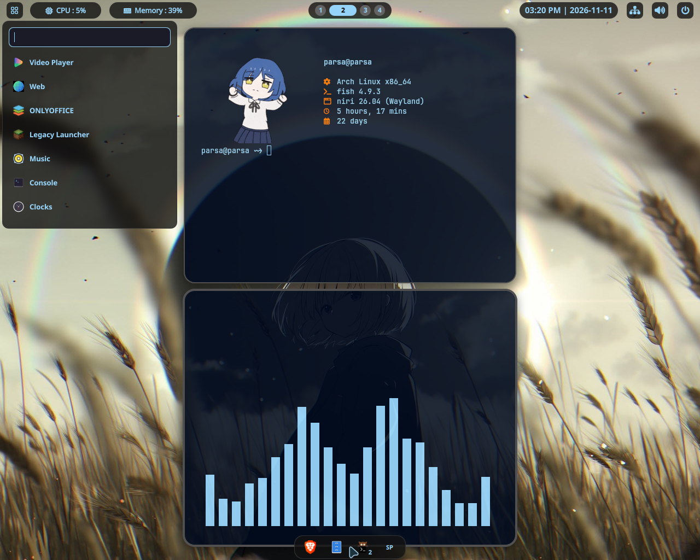
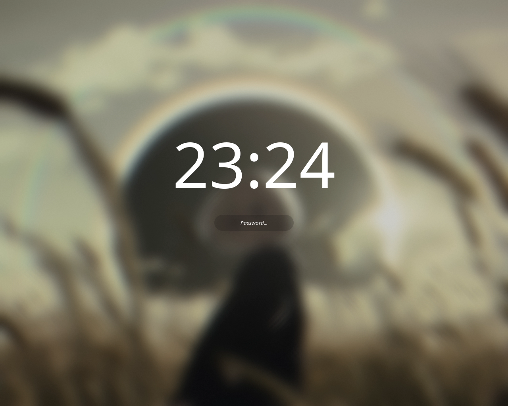
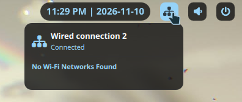
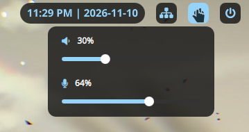
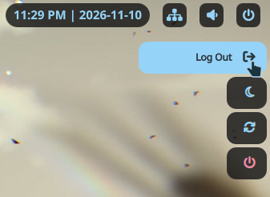

## YakhMan's niri-based DotFiles

My custom Dot-files using quickshell and niri. 

*please read the whole readme file and the install script* 


> ## 🔴 THIS ONLY WORKS ON ARCH BASED DISTROS 🔴 
> ### This setup is built for **Arch Linux AND Arch-based distros** and is **not** compatible with any  other distros.

> ## ⚠️ Not beginner-friendly 
> This is my personal config, shared with you, It can have bugs and unfinished bits, and I try as much as possible to add new features to this so i'll be happy to hear your ideas or solutions for this project :D.

## Features

most of the things here are created in one single quickshell config so there isn't much to run separately. 


for important shortcuts you can press `Super + Shift + /`.


- **Bar**: including a fully custom app launcher, cpu & memory monitor widgets, workspaces show as small     circles up to 10 visible circles at the same time, clock and date, a widget for connection info            (disappears after a period of inactivity)

- **Notifications**: nothing much just customized for looks

- **Volume**: a tiny square with the ability to change the speaker volume with scrolling and a  custom       panel including microphone and speaker volumes (also disappears after a period of inactivity)

- **Lock screen**: blurred wallpaper with a clock at the center 

- **Power menu** including a minimal button for suspend, reboot, shut down and log-out options 
 
- **task bar**: a little hidden island at the bottom of screen with opened app icons 

- **wallpaper manager**: a wallpaper manager using wallpick (synced with blurred wallpaper of lockscreen) 


## Important shortcuts

- **Exit niri**: `Super + Shift + E`

- **Lock screen**: `Super + L`

- **Kitty**: `Super + T`

- **Nautilus file manager**: `Super + G`

- **Default browser**: `Super + B`
  (u should config it manually in niri if its not brave)

- **Window size layout**: `Super + R`

- **Closing an app**: `Super + esc`

- **Wallpaper manager**: `F7`

- **ShortCuts list**: `Super + Shift + /`


## Also included

Configs for fish, kitty, fastfetch and etc.


btw the keyrings don't unlock when u disable the greeter and use the lockscreen instead so i just made them unlock by default if you got any issue or solve for it i'd be happy to hear about it!

## Installation

```bash
git clone https://github.com/YakhMan/Minimal-Niri-Dot-Files.git
cd Niri-DotFiles
bash ./install.sh
```
and thats it!


## Thanks to:

- [Quickshell](https://quickshell.org/) — the toolkit that makes this whole shell possible

- [Wallpick](https://github.com/iamanuclearwarhead/wallpick) — the wallpaper manager
  
- and my 17y.o system that is finally stable in arch lol

- also i made this configuration with the help of DeepSeek (chinese ai chatbot)

## Preview:
<p align="center">
  
  
  
  
  
</p>
